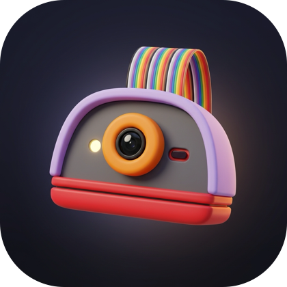
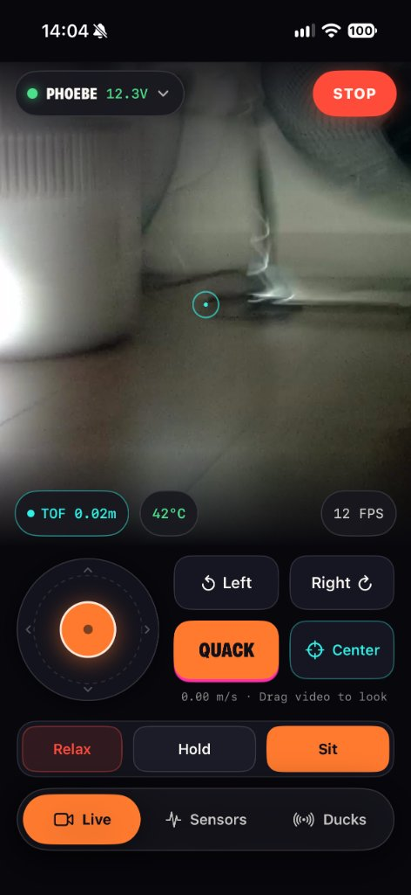
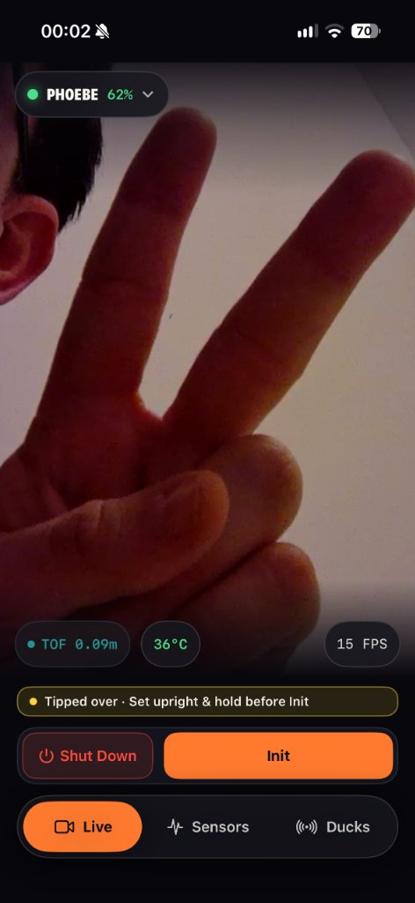
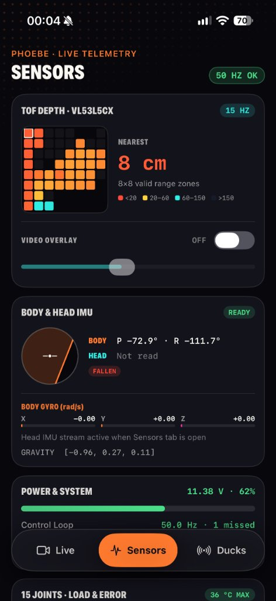
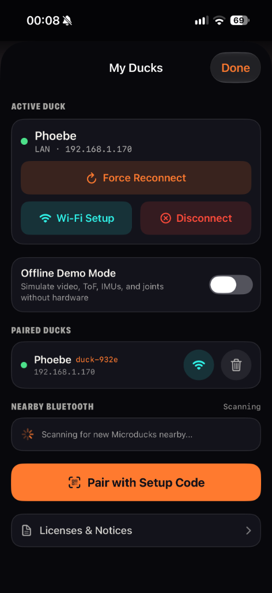

<p align="center">
  
</p>

<h1 align="center">QuackDeck</h1>

<p align="center">
  Native iPhone cockpit for Microduck robots — including official Pollen Robotics Microducks and forks.
</p>

<p align="center">
  <a href="#screenshots">Screenshots</a> ·
  <a href="#features">Features</a> ·
  <a href="#quick-start">Quick Start</a> ·
  <a href="#building--testing">Building &amp; Testing</a> ·
  <a href="#robot-safety">Safety</a> ·
  <a href="#license--notices">License</a>
</p>

---

QuackDeck pairs an adaptive SwiftUI iPhone cockpit (Portrait and Landscape) with hardware-accelerated WebRTC video decoding (H.264 High profile), CoreBluetooth onboarding, and a Rust static core compiled directly from upstream [Microduck](https://github.com/pollen-robotics/microduck) protocol crates.

> **Compatibility & Installation:** Targets **iPhone (iOS 17.0+)** and Microduck robots running protocol-compatible daemons (`pollen-robotics/microduck` `daemon-v0.23.0` and community forks). Currently built from source with Xcode — works with either a free Apple ID or a paid Apple Developer account.

## Screenshots

<table>
  <tr>
    <td align="center">
      <br />
      <sub><b>Live Driving Cockpit</b></sub>
    </td>
    <td align="center">
      <br />
      <sub><b>Standby &amp; Power Controls</b></sub>
    </td>
    <td align="center">
      <br />
      <sub><b>Sensors &amp; ToF Heatmap</b></sub>
    </td>
    <td align="center">
      <br />
      <sub><b>My Ducks &amp; Pairing</b></sub>
    </td>
  </tr>
</table>

## Features

- **Low-latency WebRTC video with Portrait framing:** Native `VideoToolbox` H.264 decoding supporting High profile alongside constrained and baseline profiles, automatic camera rotation (`media.video`), and Portrait **Full frame** vs **Fill screen** switching (corner toggle + double-tap on the video feed) that keeps the ToF depth overlay and drag-to-look gaze aligned across modes.
- **Configurable 8×8 ToF overlay:** Live VL53L5CX depth grid rendered over the camera feed with persisted on/off and opacity controls (`5%–100%`).
- **Adaptive touch cockpit:** No gamepad required — virtual drive thumbstick, zero-delay turn rocker, drag-to-look head aiming, physical left/right **Kick L** & **Kick R** actions in Portrait (`P3`) and Landscape (`L2`), and state-driven posture controls (`Init`, `Walk`, `Hold`, `Sit`, `Stand`, `Relax`, `Shut Down`).
- **Dynamic robot emotions:** Discovers available emotion skills from the daemon (`SubscribeResult.skills` minus policy skills) and triggers `robot.do` animations in `U5 Walking` and `U6b Seated` via a floating auto-closing glass **Emote** picker (with `May sit` badges on posture-changing emotions like `devastated`).
- **Secure onboarding & reconnect:** CoreBluetooth discovery, `md1:` QR / setup-code pairing with `Noise_NNpsk0` encryption, Wi-Fi provisioning, and bounded-backoff LAN auto-reconnect.
- **Live telemetry dashboard:** 8×8 ToF depth heatmap, body & head IMU attitude, battery & system health, and 15-joint load/tracking-error grid.
- **Offline Demo Mode:** Simulate video, ToF, IMUs, joints, all 13 default emotions, and full posture/shutdown lifecycles without hardware.

## Quick Start

- **Try without a robot:** Open the **Ducks** tab and turn on **Offline Demo Mode** to explore the full Portrait/Landscape cockpit, posture controls, and telemetry dashboard.
- **Pair a Microduck:** Open **Ducks**, pick your robot under **Nearby Bluetooth** (or tap **Pair with Setup Code** to scan the QR code or paste an `md1:` setup code), configure Wi-Fi if needed, and connect over LAN.
- **Toggle the ToF video overlay:** Tap the **TOF** pill on the live video feed (or use the **Sensors** tab) to turn the 8×8 depth overlay on or off and adjust its opacity.

## Building & Testing

### Prerequisites

- **Apple Silicon Mac** (`arm64`) with **Xcode 16+** and iOS 17.0+ SDK
- **Rust 1.85+** (required for Rust 2024 edition) with iOS targets installed:
  ```bash
  rustup target add aarch64-apple-ios aarch64-apple-ios-sim
  ```
- [XcodeGen](https://github.com/yonaskolb/XcodeGen) (`brew install xcodegen`)

### Build & Run Tests

1. Run Rust unit tests:
   ```bash
   cd rust && cargo test
   ```
2. Build `QuackDeckCore.xcframework` (`debug` for Simulator, `release` for physical iPhone builds):
   ```bash
   ./scripts/build-rust.sh debug
   ```
3. Generate the Xcode project and open it (or run tests from the terminal):
   ```bash
   xcodegen generate
   open QuackDeck.xcodeproj
   ```
   Or run the Swift unit tests directly on any installed iOS Simulator (run `xcrun simctl list devices available` to see installed simulator names):
   ```bash
   xcodebuild test -project QuackDeck.xcodeproj -scheme QuackDeck \
     -destination 'platform=iOS Simulator,name=iPhone 17 Pro'
   ```
   To launch straight into Offline Demo Mode in Xcode or Simulator, pass `--demo` (starts in `U2 Limp`), optionally combined with `--demo-walking` (`U5 Walking`), `--sensors`, or `--landscape`.

### Installing on a Physical iPhone

Create a gitignored `ios/Local.xcconfig` with your Apple Developer Team ID and your own bundle identifier:

```xcconfig
DEVELOPMENT_TEAM = YOUR_APPLE_TEAM_ID
QUACKDECK_BUNDLE_IDENTIFIER = com.example.quackdeck
```

Then build the release Rust core, regenerate the Xcode project, and build/install from Xcode (or `xcodebuild`):

```bash
./scripts/build-rust.sh release
xcodegen generate
open QuackDeck.xcodeproj
```

### Building Against a Local Microduck Fork

By default, `rust/quackdeck-core/Cargo.toml` pulls `duck-auth`, `duck-ble`, and `duck-ipc-proto` from upstream `https://github.com/pollen-robotics/microduck.git` (`daemon-v0.23.0`). To build against a local fork checkout instead, create a gitignored `rust/.cargo/config.toml`:

```toml
[patch."https://github.com/pollen-robotics/microduck.git"]
duck-auth = { path = "/path/to/your/microduck/duck-auth" }
duck-ble = { path = "/path/to/your/microduck/duck-ble" }
duck-ipc-proto = { path = "/path/to/your/microduck/duck-ipc-proto" }
```

## Robot Safety

- Hold the robot before enabling torque, taking torque off, or starting a policy.
- Relaxing servos (`Relax`) always prompts for confirmation because joints go limp immediately.
- Shutting down the robot (`Shut Down` when motors are off, or inside the `Relax` menu when motors are on) prompts with state-specific safety guidance before sending `robot.shutdown`, then disconnects cleanly without auto-reconnecting.
- Backgrounding the app or locking the phone zeroes stick commands and closes active motion intents.
- Monitor servo temperatures in the live HUD and Sensors dashboard; high-load servos on some Microduck forks warm up quickly while standing or walking (`warn >= 52 °C`, `hot >= 58 °C`) — keep runs short and allow servos to cool below `40 °C`.

## Repository Layout

- [`ios/QuackDeck`](ios/QuackDeck) — SwiftUI cockpit, `WebRTC` integration, CoreBluetooth manager, Keychain vault, sensor views, `Assets.xcassets`, and Offline Demo Mode.
- [`ios/QuackDeckTests`](ios/QuackDeckTests) — Swift unit tests (`CoreBridgeTests`, `ProtoModelsTests`, `DemoSessionTests`, `CockpitStateTests`, `LegalNoticesTests`).
- [`rust/quackdeck-core`](rust/quackdeck-core) — Rust C-ABI library wrapping `duck-ble`, `duck-auth`, and `duck-ipc-proto`, plus Noise TCP tunnels on `:9443` (WebSocket signalling) and `:9444` (NDJSON JSON-RPC).
- [`scripts/build-rust.sh`](scripts/build-rust.sh) — Builds `QuackDeckCore.xcframework` for iOS devices (`aarch64-apple-ios`) and iOS Simulator (`aarch64-apple-ios-sim`).
- [`project.yml`](project.yml) & [`ios/Signing.xcconfig`](ios/Signing.xcconfig) — XcodeGen specification and shared signing config (optionally includes gitignored `ios/Local.xcconfig`).
- [`docs/robot-state-machine.md`](docs/robot-state-machine.md) & [`AGENTS.md`](AGENTS.md) — Wire `robotd` state machine (S0–S10), protocol invariants, and architecture notes.
- [`LICENSE`](LICENSE), [`NOTICE`](NOTICE), [`THIRD_PARTY_NOTICES.md`](THIRD_PARTY_NOTICES.md), & [`LICENSES/`](LICENSES/) — Apache-2.0 license, Pollen Robotics notices, and third-party license texts (bundled into the app).

## Contributing

- Edit [`project.yml`](project.yml) instead of modifying generated `.xcodeproj` files directly.
- Keep wire protocol logic (`duck-ble`, `duck-auth`, `duck-ipc-proto`) inside the Rust core rather than duplicating framing or Noise handshakes in Swift.
- See [`AGENTS.md`](AGENTS.md) and [`docs/robot-state-machine.md`](docs/robot-state-machine.md) for protocol invariants and hardware safety requirements.

## License & Notices

QuackDeck is licensed under the **Apache License, Version 2.0** (`Copyright 2026 Rafael Caricio`) — see [`LICENSE`](LICENSE) and [`NOTICE`](NOTICE).

### Pollen Robotics License Compliance

- QuackDeck links against Pollen Robotics' upstream Microduck crates (`duck-auth`, `duck-ble`, `duck-ipc-proto`) from [pollen-robotics/microduck](https://github.com/pollen-robotics/microduck), which are also licensed under the **Apache License, Version 2.0**. The full license and attribution notices are included in [`LICENSE`](LICENSE) and [`NOTICE`](NOTICE) and bundled inside the iOS app under **My Ducks -> Licenses & Notices**.
- QuackDeck does **not** include Pollen Robotics' 3D CAD/STL model files (separately licensed under CC BY-NC-SA 4.0 in `pollen-robotics/microduck_rl`) or Pollen Robotics logos/brand assets.
- **Trademark & non-affiliation notice:** QuackDeck is an independent, unofficial open-source project and is not affiliated with, endorsed by, or sponsored by Pollen Robotics. "Pollen Robotics" and "Microduck" are trademarks of Pollen Robotics used solely to describe compatibility and upstream crate origin.

See [`NOTICE`](NOTICE) and [`THIRD_PARTY_NOTICES.md`](THIRD_PARTY_NOTICES.md) for complete third-party attribution and license texts (including `stasel/WebRTC` / Google WebRTC under BSD 3-Clause and statically linked Rust crates).
