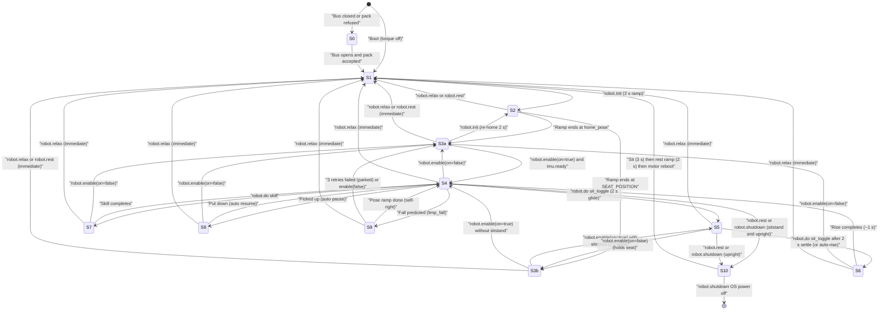

# Microduck Robot State Machine (Wire Reference)

Authoritative protocol reference for `robotd` bring-up, posture, locomotion, and power-off state transitions as observed over the WebRTC `"control"` datachannel.

## Upstream sources of truth

In [pollen-robotics/microduck](https://github.com/pollen-robotics/microduck):

- Control loop, bring-up states (`Bringup`, `LimpFall`, `RestRamp`), and RPC dispatch: `robotd/src/main.rs`
- Policy scheduler (`Controller`, `Sit`, `Driving`, `sit_toggle`): `robotd/src/control.rs`
- Intent slots (`Intents`, `PowerRequest`, `SkillRequests`): `robotd/src/intents.rs`
- Posture classification at torque-on and policy-start (`Standing`, `Seated`, `Lying`, `Unsure`): `robotd/src/posture.rs`
- Bus, battery pack, and `[home]` bring-up gates (`EnableGate`, `Checks`): `robotd/src/checks.rs`
- Pickup pause detector: `robotd/src/pickup.rs`
- Safety layer (`Safety`, `fallen`, `deadman`, `gain`): `duck-control/src/safety.rs`
- Wire JSON-RPC types (`RobotState`, `SafetyState`, `PoliciesResult`, `SubscribeResult`, `HealthResult`, `IntentResult`): `duck-ipc-proto/src/lib.rs`
- WebRTC datachannel allowlist: `mediad/src/route.rs`

---

## 1. WebRTC `"control"` Datachannel RPC Surface

All posture, bring-up, policy, and safety RPCs are permitted over the WebRTC datachannel (`mediad/src/route.rs`):

- **Permitted:** `robot.subscribe`, `robot.policies`, `robot.health`, `robot.mode`, `robot.model`, `robot.init`, `robot.enable`, `robot.do`, `robot.stop`, `robot.relax`, `robot.rest`, `robot.shutdown`, `robot.rebootMotors`, `robot.move`, `robot.head`, `robot.look`, `robot.pose`, `robot.mouth`, `robot.sound`.
- **Refused over WebRTC:** `robot.safeToRestart`, `robot.setMode`, `robot.modelApi`.

---

## 2. State Diagram

---

## 3. Observable Wire State Model (S0–S10)

No single RPC carries the full robot state. Clients must combine four wire sources:

1. **`robot.state` stream (`robot.subscribe { hz: 2 }` in Live, `{ hz: 10 }` in Sensors):** provides `policy`, `safety.{fallen, limp, picked_up, gravity, gain}`, `move.{requested, applied, limited_by}`, `joints`, `targets`, `currents_ma`, `imu`.
2. **`robot.subscribe` acknowledgement (`SubscribeResult`):** provides loaded file names (`walk`, `stand`, `sitstand`, `ground_pick`, `skills`) and `unavailable` (why no policy is loaded, if any).
3. **`robot.policies` (`PoliciesResult`):** provides `homed: Option<bool>`, `sitting: Option<bool>`, `enabled: bool` (config flag `[policy] enabled`), `mode`, `skills`, and per-slot `slots: [PolicySlot]`.
4. **`robot.health` (`HealthResult`):** provides `healthy`, `degraded`, `reason`, `imu.{ready, missing, consecutive_stale_blocks}`, `bus.{startup_failures, consecutive_errors, missing}`, `battery`, `motors.{hottest, max_c, mean_c}`.

### Polling and refresh rules

Because `homed` and `sitting` live on `robot.policies` (not on `robot.state`), clients should fetch `robot.policies`:

- Immediately when the `"control"` datachannel opens (alongside `robot.subscribe`, `media.video`, `system.info`, `robot.model`, and `robot.health`).
- On the 2 s background poll loop alongside `robot.health`.
- Immediately whenever `robot.state.policy` changes value (for example `"homing" -> "held"`, `"sit" <-> "rise" <-> "walk"`, `"rest" -> "held"`).
- Immediately after sending any discrete posture RPC (`robot.init`, `robot.enable`, `robot.do`, `robot.relax`, `robot.rest`, `robot.rebootMotors`).

### Wire state table

| State | Name | `state.policy` | `policies.homed` | `policies.sitting` | Other wire signals | Meaning |
|---|---|---|---|---|---|---|
| **S0** | Bus / Hardware Blocked | *(no frames if `ticks == 0`, else `"held"`)* | `false` | `false` | Hard block predicate: `health.bus.startup_failures > 0`, OR `health.control_loop?.ticks == 0`, OR `!health.bus.missing.is_empty()`, OR `health.imu?.missing == true`, OR `(health.degraded && health.reason?.contains("torque stays off") == true)` | Servo bus not open yet, loop starting, hardware missing, or battery pack rejected (for example, a 3S pack guard checking 9.9–14.0 V in the first 3 s at boot). While blocked in `adopt_startup_pose` (`ticks == 0`), `robotd` emits **no `robot.state` frames**, so clients must evaluate S0 from `robot.health` without waiting for `robot.state`. `robot.init` and `robot.enable` are refused. Other `degraded` warnings (policy fallback, `config_error`, `servo status`, historical safety trip) and `cpu_throttle` do NOT block `robot.init`. |
| **S1** | Limp (Torque Off) | `"held"` | `false` | `false` | `safety.limp == false` | Default at boot, after `robot.relax`, after `robot.rest`, or after `robot.rebootMotors`. Servos have no torque. |
| **S2** | Homing (Ramping) | `"homing"` | `false` | `false` *(or `true` if seated at torque-on)* | Duration `HOME_RAMP = 2.0 s` | Torque is ON; joints ramp linearly over 2 s to `home_pose` (or `SEAT_POSITION` if detected seated at torque-on with `imu.ready` and `sitstand`). |
| **S3a** | Ready — Held at Home | `"held"` | `true` | `false` | `safety.picked_up == false`; `health.imu.ready` may be `false` or `true` | Torque is ON, holding `home_pose`, policy not stepping. Also matches two edge sub-states: **IMU-Waiting** (after `enable(true)` while `!imu.ready`) and **Standup-Parked** (after 3 failed stand-up retries while `fallen == true`). |
| **S3b** | Ready — Held in Seat | `"held"` | `true` | `true` | `safety.picked_up == false` | Torque is ON, holding seated pose, policy disabled (brought up via `robot.init` while seated, or `enable(false)` sent while seated). |
| **S4** | Driving — Upright (Stand/Walk) | `"walk"` or `"stand"` | `true` | `false` | `safety.limp == false` | Policy active and balancing. With default `velstand.onnx`, `policy` is `"walk"` both when moving and when standing still at zero velocity. `"stand"` appears only if a separate `stand` slot is configured and `|twist| <= 0.05`. |
| **S5** | Driving — Sitting / Seated | `"sit"` | `true` | `true` | First ~2.0 s (`sitstand_ramp_s`) is the descent glide (`sit_settle > 0`); then latched seated | `sitstand` policy holding seat (`twist` forced to `[1, 0, 0]`). `robot.move` is ignored; `robot.look` stays active. `sit_settle` is not exposed on the wire. |
| **S6** | Driving — Rising | `"rise"` | `true` | `false` | Duration `sitstand_rise_s = 1.0 s` | `sitstand` policy rising from seat back to standing; automatically transitions to **S4**. |
| **S7** | Driving — One-Shot Skill | `"ground_pick"`, `<skill>`, or `<skill>:unwind` | `true` | `false` | `controller.busy() == true` | Scripted skill in flight; blocks `sit_toggle` and other skills until complete. |
| **S8** | Picked Up (Paused) | `"held"` | `true` | `false` | `safety.picked_up == true` | `[pickup]` paused driving while robot is held in hands; automatically resumes **S4** when put back on the floor. |
| **S9** | Falling / Recovering | `"limp_fall"` then `"limp_pose"` | `true` | `false` | `"limp_fall"` has `safety.limp == true` (`gain = 50`, <= 1.5 s); `"limp_pose"` has `safety.limp == false` (`gain = 160`, 0.6 s) | Automatic `[safety] limp_fall` sequence. Hands back to **S4** to self-right (up to 3 retries of 3 s each; if all fail, parks stiff at home until manually stood upright and still for 1 s, or disabled and re-enabled). |
| **S10** | Resting / Shutting Down | `"sit"` (~3 s) then `"rest"` (2 s) | `true` then `false` | `true` then `false` | `robot.rest` ends in **S1** after motor reboot; `robot.shutdown` powers off OS | Controlled sit (`sitstand_ramp_s + 1.0 s = 3.0 s`), then `RestRamp` (`REST_RAMP = 1.0 s` linear ramp to `REST_POSITION` + `REST_HOLD = 1.0 s`), then torque off. |

---

## 4. Command Semantics

| Command | Wire call | Exact behavior |
|---|---|---|
| **Init** | `robot.init` | Turns torque ON and runs a 2 s linear ramp (`Homing`) to `home_pose` (or `SEAT_POSITION` if `imu.ready && has_sitstand && posture == Seated`), ending in **S3a/S3b**. Does not start the policy. Works even when `[policy] enabled = false`. Refused only when hardware/battery gate blocks torque (`EnableGate::NoPower`). |
| **Enable ON** | `robot.enable { "on": true, "toggle": false }` | Starts the locomotion policy. From **S1 (Limp)**: turns torque ON and ramps 2 s; on builds with `policy_on_arrival = false` stops at **S3a** and clears `enabled` (requires a second `enable(true)`); on official Microducks (`policy_on_arrival = true`) starts driving on arrival. From **S2 (Homing)**: refused when `policy_on_arrival = false` (`EnableGate::NoStart`). From **S3b (Held in Seat)**: runs `settle_then_rise` (~2 s `"sit"` then ~1 s `"rise"` then **S4**) if `sitstand` and `imu.ready` are available. Refused if no policy is loaded or battery is refused. |
| **Enable OFF** | `robot.enable { "on": false, "toggle": false }` | Disables the policy while keeping torque ON. Stops any active skill, rise, `limp_fall`, or pickup pause. If upright, commands `home_pose` directly (no 2 s ramp) -> **S3a**. If seated, holds the current seated pose and keeps `sitting == true` -> **S3b**. |
| **Sit / Stand Toggle** | `robot.do { "skill": "sit_toggle" }` | Requires policy enabled (`intents.enabled`), `homed == true`, and `sitstand` policy loaded. From **S4**: starts ~2 s glide down -> **S5**. From **S5** (once 2 s settle finishes): starts ~1 s rise (**S6**) -> **S4**. Refused at RPC dispatch if `!enabled`, `!homed`, or `sitstand` absent; accepted then dropped in the control loop if still settling down, already rising, or another skill is busy. |
| **Stop** | `robot.stop` | Zeroes velocity twist `[0, 0, 0]` only (same effect as releasing the thumbstick or the 500 ms deadman). Never disables the policy, never cuts torque, and never changes sit/stand state. It is not a physical emergency stop. |
| **Relax** | `robot.relax` | Cuts torque immediately (`set_torque(false)`), clears `enabled`, and forgets seat and skill state -> **S1 (Limp)**. Never refused. The robot collapses immediately if not held. |
| **Rest** | `robot.rest` | Runs controlled sit (~3 s) -> `RestRamp` (2 s) -> torque off + motor reboot -> **S1 (Limp)** **only when `enabled && homed && !fallen && has_sitstand`**. In every other state (including **S3a Held at Home**, **S2 Homing**, fallen, or missing `sitstand`), cuts torque and reboots motors immediately. |
| **Shutdown** | `robot.shutdown` | Same controlled sit + rest vs immediate torque-cut rule as `robot.rest`, followed by OS power-off (drops connection). Also triggered automatically when the 10 s battery EMA reaches empty (`<= 6.6 V` on 2S; `<= 9.9 V` on 3S forks). |
| **Reboot Motors** | `robot.rebootMotors { "ids": [] }` | Cuts torque immediately on all joints, clears `enabled`, forgets seat/skills, and reboots the listed servo IDs (empty array = all 15 servos using upstream IDs `20-24`, `30-34`, `10-14`) -> **S1 (Limp)**. |
| **Move** | `robot.move { "vx", "vy", "vyaw" }` | Velocity command (`maxLinearSpeed = 0.3`, `maxAngularSpeed = 1.5`), resent at 10 Hz while non-zero. Zeroed after 500 ms deadman. Applied only in **S4** (ignored when disabled, homing, seated, picked up, or in `limp_fall`). |
| **Look** | `robot.look { "x", "y", "z", "neck_pitch" }` | Head gaze IK target. Always returns `LookResult { head, clamped }` with no error and updates `intents.head`. **Physically moves the head only while `driving == true` (**S4**, **S5**, **S6**).** In **S1**, **S2**, **S3a**, **S3b**, **S8**, **S9**, and **S10**, `command.head` is not applied to motor targets (physical no-op until driving starts). |
| **Sound** | `robot.sound { "tag": "chirp" }` | Plays a voice-bank sound without moving servos. Works in **any** state (including **S1 Limp**, **S3a/S3b Held**, **S4**, **S5**) as long as audio/voice bank is enabled; refused only if the robot has no voice. |

---

## 5. Full State × Command Transition Matrix

| State | `robot.init` | `enable(true)` | `enable(false)` | `do sit_toggle` | `robot.stop` | `robot.relax` | `robot.rest` | `robot.shutdown` | `robot.rebootMotors` | `robot.move` | `robot.look` |
|---|---|---|---|---|---|---|---|---|---|---|---|
| **S0 Blocked** | Refused (`NoPower` / battery) | Refused (`NoPower` / battery) | Accepted (no-op) | Refused (`!enabled`) | No-op | Accepted (stays S0/S1) | Immediate reboot | Immediate power-off | Reboots servos | Ignored | Accepted (not applied) |
| **S1 Limp** | **Valid** -> **S2** (2 s ramp) -> **S3a/S3b** | Avoid: with `policy_on_arrival = false` ramps 2 s -> **S3a** & clears `enabled`; with `policy_on_arrival = true` starts driving on arrival | No-op | Refused (`!enabled`) | No-op | Idempotent (S1) | Immediate reboot (S1) | Immediate torque-off & power-off | Reboots servos (S1) | Ignored | Accepted (not applied) |
| **S2 Homing (~2 s)** | No-op in loop | Refused when `policy_on_arrival = false` (`NoStart`); latches when `true` | Clears `enabled` (ramp finishes -> **S3a**) | Refused (`!homed` / `!enabled`) | No-op | **Aborts ramp -> S1** (drops!) | **Aborts -> immediate torque-off & reboot -> S1** (drops!) | **Aborts -> immediate torque-off & power-off** | **Aborts -> torque-off & reboot -> S1** | Ignored | Accepted (applied once driving) |
| **S3a Held at Home** | Re-homes 2 s -> **S2 -> S3a** | **Valid** -> **S4** (if `imu.ready`, else waits in S3a until ready; refused if no policy) | No-op | Refused (`!enabled`) | No-op | **Valid** (confirm + hold) -> **S1** | **Immediate torque-off & reboot -> S1** (no sit; drops!) | **Immediate torque-off & power-off** (no sit; drops!) | Immediate torque-off & reboot -> **S1** | Ignored | Accepted (applied once driving) |
| **S3b Held in Seat** | **No-op** (holds seat; refuses re-home) | **Valid** -> if `sitstand && imu.ready`: **S5** (2 s settle) -> **S6** (1 s rise) -> **S4**; else **S4** | No-op | Refused (`!enabled`) | No-op | **Valid** (confirm + hold) -> **S1** | **Immediate torque-off & reboot -> S1** (already seated) | **Immediate torque-off & power-off** | Immediate torque-off & reboot -> **S1** | Ignored | Accepted (applied once driving) |
| **S4 Driving (Walk/Stand)** | Avoid: 2 s re-home; **disables policy when `policy_on_arrival = false`**, resumes driving when `true` | No-op (already on) | **Valid** -> direct `home_pose` -> **S3a** | **Valid** (if `sitstand`) -> **S5** (~2 s glide down -> seated); refused if no `sitstand` | **Valid**: zeroes twist (stays **S4**) | **Valid** (confirm + hold) -> **S1** (drops!) | **Valid**: if `sitstand && !fallen` -> **S10** (~5 s) -> **S1**; else immediate torque-off | If `sitstand && !fallen` -> **S10** (~5 s) -> power-off; else immediate power-off | Immediate torque-off & reboot -> **S1** (drops!) | **Valid** (10 Hz, 500 ms deadman) | **Valid** |
| **S5 Driving — Seated** | **No-op** (holds seat) | No-op | **Valid** -> holds seat (`sitting=true`) -> **S3b** | **Valid after ~2 s settle** -> **S6** (1 s rise) -> **S4** (dropped silently during 2 s settle) | No-op | **Valid** (confirm + hold) -> **S1** | **Valid**: if `!fallen` -> **S10** (~5 s) -> **S1**; else immediate torque-off | If `!fallen` -> **S10** (~5 s) -> power-off; else immediate power-off | Immediate torque-off & reboot -> **S1** | Ignored (twist forced to `[1,0,0]`) | **Valid** |
| **S6 Rising (~1 s)** | Avoid (re-homes) | No-op | Cuts rise -> `Sit::Up` -> `home_pose` -> **S3a** | Dropped (`"already standing up"`) | Zeroes twist | **Valid** -> **S1** (drops!) | Starts **S10** -> **S1** (if `!fallen && sitstand`) | Starts **S10** -> power-off | Immediate torque-off & reboot -> **S1** | Held until **S4** | **Valid** |
| **S7 One-Shot Skill** | Avoid (re-homes) | No-op | Stops skill -> `home_pose` -> **S3a** | Dropped (busy) | Zeroes twist | **Valid** -> **S1** (drops!) | Starts **S10** -> **S1** (if `!fallen && sitstand`) | Starts **S10** -> power-off | Immediate torque-off & reboot -> **S1** | Overridden by skill | Overridden by skill |
| **S8 Picked Up** | Avoid (re-homes) | No-op | Ends pause -> **S3a** | **Danger:** accepted and **cancels pickup pause**, running `sitstand` in mid-air (hide in UI) | Zeroes twist | **Valid** -> **S1** | **Danger:** cancels pickup pause and runs **S10** sit in mid-air if `!fallen && sitstand` (hide in UI) | Cancels pickup pause and runs **S10** or immediate power-off | Immediate torque-off & reboot -> **S1** | Ignored until put down | Ignored until put down |
| **S9 Falling (`limp_fall` / `limp_pose`)** | Avoid | No-op | Abandons recovery -> **S3a** (holds pose) | Avoid | Zeroes twist | **Valid** -> **S1** | Immediate torque-off if `fallen` | Immediate power-off if `fallen` | Immediate torque-off & reboot -> **S1** | Forced `[0, 0, 0]` | Ignored |
| **S10 Resting / Shutting Down** | Ignored | Ignored | Interrupts sit if still in sit phase (avoid) | Ignored (`shutdown_sit` blocks skills) | No-op | Cuts torque immediately (`Bringup::Limp`), **but does NOT clear `shutdown_sit`/`shutdown_rest`**: timer still finishes with motor reboot (for `rest`) or OS `poweroff()` (for `shutdown`), emitting `"rest"` briefly with torque off | Already running | Upgrades rest to power-off after rest completes | Immediate torque-off & reboot -> **S1** (clears `rest` timers) | Ignored | Ignored |

---

## 6. Protocol Pitfalls and Edge Cases

1. **`safety.limp` does NOT mean torque off (`Bringup::Limp`).**
   - `robot.state.safety.limp` is only `true` during `LimpFall::Limp` (`gain_limp = 50`).
   - When torque is actually OFF (**S1**), `robot.state` reports `policy: "held"`, `safety.limp: false`, and `safety.gain: Some(200)`.
   - Use `PoliciesResult.homed == Some(false)` together with `robot.state.policy == "held"` to identify **S1 (Limp)**.
2. **`PoliciesResult.enabled` is a static config constant, NOT runtime policy enable.**
   - `PoliciesResult.enabled` reflects `[policy] enabled` in `robotd.toml`.
   - Runtime `intents.enabled()` is not published directly on the wire; infer active driving from `robot.state.policy` (`"walk"`, `"stand"`, `"sit"`, `"rise"`, `"ground_pick"`, skill name, `"limp_fall"`, `"limp_pose"`), `safety.picked_up`, and `PoliciesResult.{homed, sitting}`.
3. **`velstand.onnx` has no separate `stand` slot.**
   - Default Microduck policy sets ship `velstand.onnx` in the `walk` slot with `stand = None`.
   - While upright and balancing at zero velocity, `robot.state.policy` reports `"walk"`, not `"stand"`. Only robots with a separate `stand` network report `"stand"` when `|twist| <= 0.05`.
4. **`[home] policy_on_arrival` differs across builds.**
   - Official Microducks default to `policy_on_arrival = true`: `robot.enable(on: true)` from **S1** homes and starts driving immediately; `robot.init` while driving (**S4**) re-homes and resumes driving.
   - Some forks set `policy_on_arrival = false`: calling `robot.enable(on: true)` from **S1 (Limp)** homes for 2 s, stops in **S3a**, and clears `enabled`, requiring a second `enable(true)`; calling `robot.init` while driving (**S4**) re-homes for 2 s and disables the policy.
   - To keep behavior consistent and safe across both configurations, always use `robot.init` to go **S1 -> S3a/S3b**, `robot.enable(on: true)` to go **S3a/S3b -> S4**, and `robot.enable(on: false)` to go **S4/S5 -> S3a/S3b**.
5. **Starting from a seated robot:**
   - Calling `robot.init` on a limp, seated robot with converged IMU and `sitstand` loaded ramps to `SEAT_POSITION` and sets `sitting = true` (**S3b**).
   - Calling `robot.init` on a robot that is already seated with torque on (**S3b** or **S5**) is a deliberate no-op so the robot does not tip over backwards.
   - To stand up from **S5 (Driving — Seated)**, send `robot.do { "skill": "sit_toggle" }` (after the 2 s settle). To stand up from **S3b (Held in Seat)**, send `robot.enable { "on": true, "toggle": false }`, which automatically settles (2 s) and rises (1 s) into **S4**.
6. **IMU convergence (`health.imu.ready == false`):**
   - IMUs such as the BNO055 need a few seconds stationary after power-on until gyro calibration converges.
   - `robot.init` still runs while `!imu.ready` (skipping the seated check and ramping straight to `home_pose`).
   - Calling `robot.enable(on: true)` while `!imu.ready` is accepted and stays `"held"`, then starts the policy automatically the moment `imu.ready` turns `true`. Clients should block or clearly warn before sending `robot.enable(on: true)` until `health.imu.ready == true`.
7. **Fallen (`safety.fallen == true`) and Picked-Up (`safety.picked_up == true`):**
   - `safety.fallen` is report-only (`gravity_z > -0.5` for 200 ms, suppressed while `!imu.ready`). It does not refuse `init`, `enable`, or `do`, but it forces `robot.rest` and `robot.shutdown` to skip sitting and cut torque immediately.
   - During self-righting after `limp_pose` (up to 3 × 3 s retries), or if `limp_fall = false`, or if a seated duck tips over, `robot.state.policy` can be `"walk"`, `"stand"`, or `"sit"` while `safety.fallen == true`. Clients should treat any driving policy with `safety.fallen == true` as fallen/recovering rather than normal driving.
   - `safety.picked_up` pauses driving into `"held"` while the robot is held in the air and resumes **S4** automatically when put down. Because neither `take_skills` nor `robot.rest` checks `!pickup_paused`, clients must hide `sit_toggle` and `robot.rest` while `safety.picked_up == true` so the robot does not try to sit in mid-air.
   - Sending `robot.relax` during **S10 (Resting / Shutting Down)** cuts torque immediately, but `robotd` keeps the `shutdown_sit`/`shutdown_rest` timer running until `rebootMotors` (for `rest`) or `poweroff()` (for `shutdown`) finishes.
8. **Missing or fork-unvalidated `sitstand` policy:**
   - When `sitstand` is absent (`PoliciesResult.slots` has `slot == "sitstand"` with `path == null`, or `SubscribeResult.sitstand == null`), `robot.do sit_toggle` is refused and `robot.rest`/`robot.shutdown` cut torque immediately without sitting.
   - Some non-XL330 hardware forks install `alpha_sitstand.onnx` without full validation on their servo hardware; operators should keep hands nearby when sitting down or standing up.

---

## 7. Hardware and Torque Safety Rules

- Always hold the robot before enabling torque (`robot.init`), taking torque off (`robot.relax`, or `robot.rest` when not driving upright with `sitstand`), or starting a policy (`robot.enable(on: true)`).
- `robot.relax` must always require explicit user confirmation because servos go limp immediately.
- Monitor servo temperatures during standing and walking (`warnTempC = 52 °C`, `hotTempC = 58 °C`); high-load servos on some forks heat up quickly — keep runs under 2–3 minutes and let servos cool below `40 °C`.
- Battery guards reject out-of-range packs at boot (refusing `robot.init` and `robot.enable`) and trigger empty-battery shutdown automatically (`<= 6.6 V` on 2S packs; `<= 9.9 V` on 3S packs).
- Turn the robot off before plugging or unplugging servos. Run locomotion policies on battery power.
